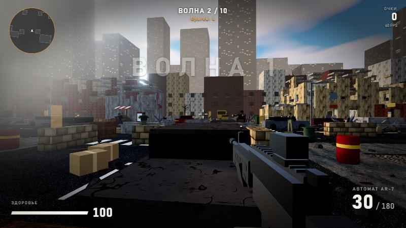

# OPERATION ASH (ОПЕРАЦИЯ «ПЕПЕЛ»)

A first-person shooter in the style of Call of Duty, set in a ruined city block. It runs in the browser on Three.js (WebGL2). No engine install, no account, no network.



## Play

- Double-click `dist/game.html` (one file, about 1 MB, everything inside), or
- `npm install` then `npm start` and open http://localhost:5174.

Rebuild the single file with `npm run build`.

## Controls

| Key | Action |
|-----|--------|
| W A S D | move |
| Shift | sprint |
| C | crouch |
| Space | jump |
| Mouse, left button | fire |
| Mouse, right button | aim down sights |
| R | reload |
| 1 2 3, mouse wheel, Q | pistol, rifle, shotgun; next; last used |
| Esc | pause and resume |
| F3 | FPS counter |

## What is in the game

- Three weapons from one data table: semi-automatic pistol, automatic rifle, pump shotgun with eight pellets.
- A 90 by 90 m block: ten ruined buildings with furnished interiors, streets, barricades, containers, a sniper perch on a container roof, and more than five thousand small instanced objects.
- Ten waves of bots, wave N has 3+2(N-1) soldiers, at most 12 alive at once, three difficulty tiers. Bots take cover, peek, and show a laser and a sound before a burst. After wave 10 you can continue in endless mode.
- Health regenerates after five quiet seconds. Crates break, barrels explode, medkits and ammo boxes respawn.
- Crosshair turns red over an enemy and an enemy health bar appears.
- Three quality presets with automatic downgrade when the frame rate drops. Settings, language (Russian, English) and sound toggle are saved.

## Graphics, honestly

Unreal Engine 5 quality (Nanite, Lumen, scanned assets everywhere) is not reachable in a browser. This game gets as far as WebGL allows: PBR materials with albedo, normal and AO/roughness/metal maps, sky with image based lighting, three-cascade sun shadows, GTAO ambient occlusion, bloom, SMAA, filmic tone mapping, fog, film grain. All textures and models are generated in code, so the result looks like a good stylized PBR game, not a photograph.

The biggest remaining step is real photoscans. The pipeline for them is built and tested with procedural fallbacks, but the files are not downloaded yet (see below).

## Optional photoscans (CC0, Poly Haven)

Nothing is downloaded unless you run these scripts yourself. Both have a dry mode that only reads the catalog.

```bash
npm run textures -- --dry   # 9 PBR sets, about 17.0 MB at 1k, jpg
npm run models -- --dry     # 5 models, about 10.7 MB, packed to .glb
npm run textures            # download into assets/textures
npm run models              # download into assets/models
npm run build               # embed them into dist/game.html
```

| Surface or prop | Poly Haven id | Size |
|-----------------|---------------|------|
| concrete | concrete_wall_008 | 1.72 MB |
| plaster | worn_plaster_wall | 1.75 MB |
| brick | red_brick_03 | 1.73 MB |
| asphalt | asphalt_floor | 3.14 MB |
| dirt | gravel_ground_01 | 2.31 MB |
| wood | weathered_brown_planks | 0.62 MB |
| metal | rusty_metal_02 | 1.07 MB |
| container | rusty_corrugated_iron | 1.60 MB |
| sandbag | hessian_230 | 3.08 MB |
| barrel | Barrel_01 | 0.66 MB |
| crate | wooden_crate_01 | 2.17 MB |
| cardboard box | cardboard_box_01 | 2.07 MB |
| concrete barrier | concrete_road_barrier | 3.58 MB |
| covered car | covered_car | 2.24 MB |

Source: https://api.polyhaven.com (CC0). A set that fails to download keeps its procedural version.

With everything embedded, `dist/game.html` grows from about 1 MB to about 37 MB (28 MB of files in base64), so it takes a few seconds to open. `npm run build:lite` keeps the small file without them.

## Project

```
src/core      pure rules, the only test seam (no three, DOM, window)
src/render    renderer, sky, shadows, post processing, materials, model loader
src/world     level, interiors, scatter, props, effects
src/player    controller, input
src/weapons   weapon models and animation
src/game      shooting, wave director
src/enemies   bot bodies around core AI
src/ui        HUD and menus
src/audio     synthesized sound
tests/core    core tests, run with npm test
tests/tools   packer tests, run with npm run test:tools
.autopilot    manifest, spec, interfaces, dashboard, progress
```

`npm run dashboard` checks the process gates and regenerates `.autopilot/dashboard.html`.
