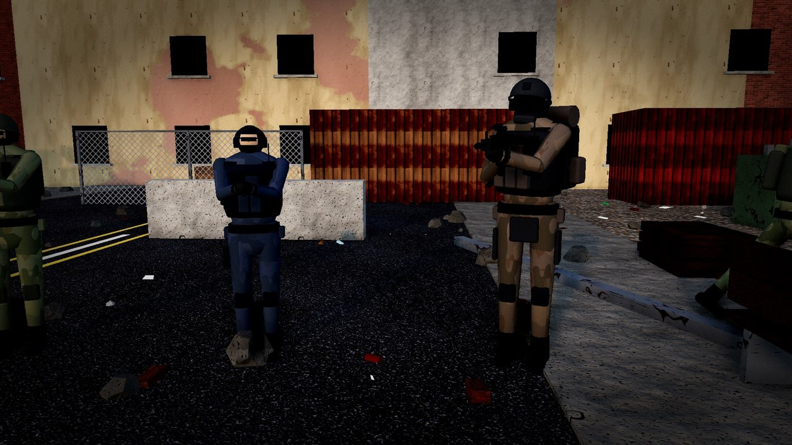
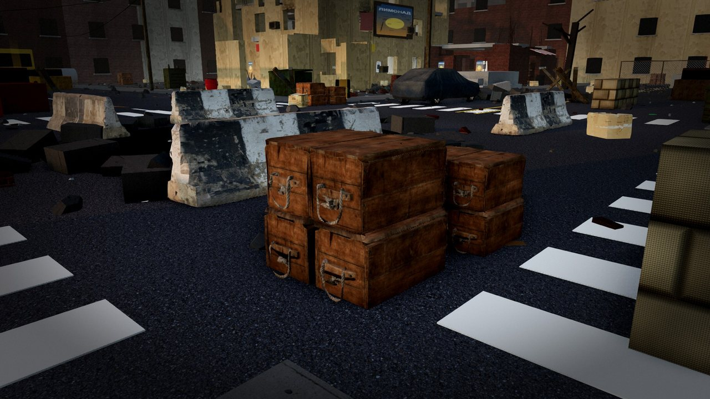

# OPERATION ASH (ОПЕРАЦИЯ «ПЕПЕЛ»)

A first-person shooter in the style of Call of Duty, set in a ruined city block. It runs in the browser on Three.js (WebGL2). No engine install, no account, no network.

**Play online: https://paschka-k.github.io/operation-ash/**






## Play

- Open the link above, or
- Double-click `dist/game.html` (one file, about 1 MB, everything inside, generated textures), or
- `npm install` then `npm start` and open http://localhost:5174.

Rebuild the single file with `npm run build`.

## Controls

| Key | Action |
|-----|--------|
| W A S D | move |
| Shift | sprint |
| C | crouch |
| Space | jump |
| Mouse, left button | fire |
| Mouse, right button | aim down sights |
| R | reload |
| 1 2 3, mouse wheel, Q | pistol, rifle, shotgun; next; last used |
| Esc | pause and resume |
| F3 | FPS counter |

## What is in the game

- Three weapons from one data table: semi-automatic pistol, automatic rifle, pump shotgun with eight pellets.
- A 90 by 90 m block: ten ruined buildings with furnished interiors, streets, barricades, containers, a sniper perch on a container roof, and more than five thousand small instanced objects.
- Ten waves of bots, wave N has 3+2(N-1) soldiers, at most 12 alive at once, three difficulty tiers. Bots take cover, peek, and show a laser and a sound before a burst. After wave 10 you can continue in endless mode.
- Health regenerates after five quiet seconds. Crates break, barrels explode, medkits and ammo boxes respawn.
- Crosshair turns red over an enemy and an enemy health bar appears.
- Three quality presets with automatic downgrade when the frame rate drops. Settings, language (Russian, English) and sound toggle are saved.

## Graphics, honestly

Unreal Engine 5 quality (Nanite, Lumen, scanned assets everywhere) is not reachable in a browser. This game gets as far as WebGL allows: PBR materials with albedo, normal and AO/roughness/metal maps, sky with image based lighting, three-cascade sun shadows, GTAO ambient occlusion, bloom, SMAA, filmic tone mapping, fog, film grain. Light shafts from the low sun, world-space colour variation that hides texture tiling, rain streaks and patches of exposed brick add to it. All textures and models are generated in code, so the result looks like a good stylized PBR game, not a photograph.

Enemy soldiers are one skinned mesh each (about five thousand triangles, twelve bones): helmet, glasses, plate carrier with pouches, pack, camouflage from a generated texture, a rifle or pistol held by solved arm poses. They are still built from simple shapes, not sculpted or scanned.

The weapons in hand are cut from side-view outlines and turned profiles instead of boxes: a pistol with a moving slide, a carbine with a slotted handguard, a rail, a curved magazine and a holographic sight you look through, a pump shotgun with spare shells on the receiver. Gloved hands have jointed fingers and camouflage sleeves. A weapon is four or five draw calls. Its light follows the world: the sun and the reflected sky turn as you turn, and the sun leaves the weapon when you step into shade. They are still modelled by code, not sculpted or scanned.

Photoscans (see below) replace eight surfaces and five props when their files are present. That moves walls, roads and crates much closer to a photograph, but the buildings and the soldiers are still modelled from simple shapes.

## Photoscans (CC0, Poly Haven)

Eight surfaces use scanned PBR textures and five props use scanned models. The files are in `assets/` (about 25 MB, CC0 from [Poly Haven](https://polyhaven.com)), and the online version loads them on the first visit, with a progress bar. The game also runs without them: delete `assets/`, or turn them off in the settings, and everything is generated in code.

The scripts below fetch the same files again from Poly Haven. Nothing is downloaded unless you run them yourself. Both have a dry mode that only reads the catalog.

```bash
npm run textures -- --dry   # 8 PBR sets, about 13.9 MB at 1k, jpg
npm run models -- --dry     # 5 models, about 10.7 MB, packed to .glb
npm run textures            # download into assets/textures
npm run models              # download into assets/models
npm start                   # the dev server picks them up from assets/
npm run build:scans         # dist/game-scans.html, one offline file with the scans inside (about 34 MB)
npm run build:web           # dist/web/: index.html (1 MB) and the scans next to it, for a web server
```

A second run only fetches what is missing, and each file is tried three times.

| Game surface | Poly Haven texture | | Prop | Poly Haven model |
|---|---|---|---|---|
| concrete | concrete_wall_008 | | barrel | Barrel_01 |
| plaster | worn_plaster_wall | | crate (a stack of four) | wooden_crate_01 |
| brick | red_brick_03 | | cardboard box | cardboard_box_01 |
| asphalt | asphalt_floor | | road barrier | concrete_road_barrier |
| ground | gravel_ground_01 | | car under a tarpaulin | covered_car |
| wood | weathered_brown_planks | | | |
| metal | rusty_metal_02 | | | |
| containers | rusty_corrugated_iron | | | |

Scans are not dropped in as they come. Each texture is fitted to the level (real tile size, brightness of the surface it replaces, the corrugated iron loses its rust colour so containers keep their paint), and each model is thinned on load from tens of thousands of triangles to a budget. Sandbags keep their generated texture: a cloth scan shows the weave but not the bags.

The switch "Photoscanned textures and models" in the settings, or `?noscans` in the address, turns them off.

## Project

```
src/core      pure rules, the only test seam (no three, DOM, window)
src/render    renderer, sky, shadows, post processing, materials, model loader
src/world     level, interiors, scatter, props (pools of instances), effects
src/player    controller, input
src/weapons   weapon shapes (sculpt, hands, guns) and their animation (viewmodel)
src/game      shooting, wave director
src/enemies   bot bodies around core AI
src/ui        HUD and menus
src/audio     synthesized sound
tests/core    core tests, run with npm test
tests/tools   packer tests, run with npm run test:tools
.autopilot    manifest, spec, interfaces, dashboard, progress
```

`npm run dashboard` checks the process gates and regenerates `.autopilot/dashboard.html`.
