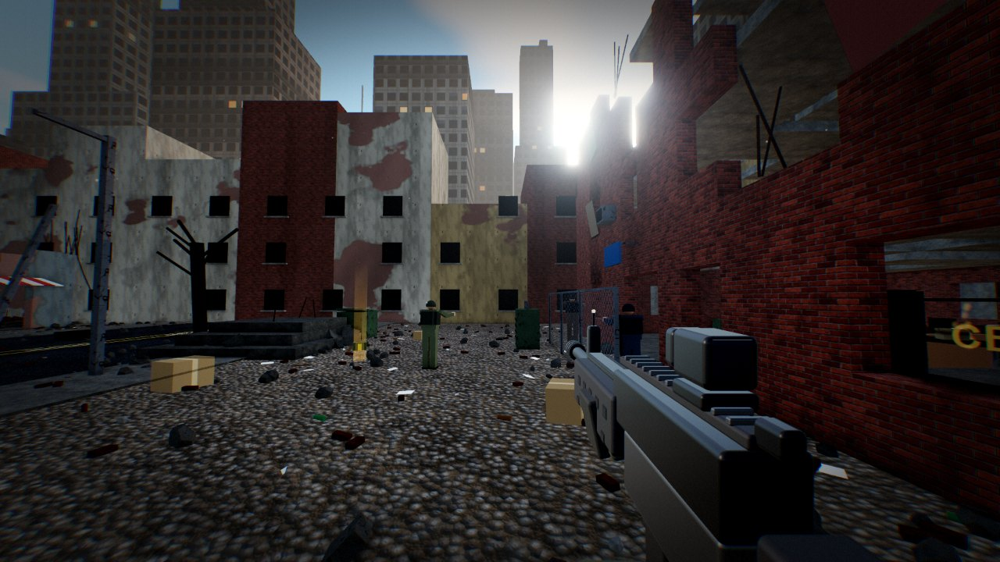

# OPERATION ASH (ОПЕРАЦИЯ «ПЕПЕЛ»)

A first-person shooter in the style of Call of Duty, fought over ten maps: a ruined city block, a port, an industrial zone, an old town, a railyard, an airfield, a winter village, a downtown at night, a desert village and a construction site. Every wave has its own map, and from wave 6 you choose the next one yourself. It runs in the browser on Three.js (WebGL2). No engine install, no account, no network.

**Play online: https://paschka-k.github.io/operation-ash/**




## Play

- Open the link above, or
- Double-click `dist/game.html` (one file, about 1 MB, everything inside, generated textures), or
- `npm install` then `npm start` and open http://localhost:5174.

Rebuild the single file with `npm run build`.

### Launcher and graphics card

A web page cannot choose the graphics card: the browser does, and on a laptop with built-in and discrete graphics it often takes the built-in one. The launcher gets around this without touching Windows or your browser settings:

- `npm run play`, or a double click on `play-windows.cmd` (Node.js and one `npm install` needed). It serves the game on 127.0.0.1 (first free port from 5180) and opens it in Chrome, otherwise Edge, as a window without browser panels. Closing the window ends the launcher. Without Chrome and Edge it says so in one line and opens your default browser.
- The window uses its own profile in `%LOCALAPPDATA%\OperationAsh\browser`; your everyday browser, its profile and flags, the registry and Windows settings are not touched. Nothing is downloaded.
- In Settings, "Play on graphics card" lists the cards of your system (names from Windows). Pick another one: the window restarts on it and opens in the main menu. Change it in the main menu or on pause; on pause the current fight is lost. The choice is kept in `%LOCALAPPDATA%\OperationAsh\launcher.json`.
- In an ordinary tab (the site, `dist/game.html`, `npm start`) the line "Graphics card" shows what the game draws on and says that the browser chooses; the choice appears only under the launcher.

Technically the fast card is the browser key `--force_high_performance_gpu`; the default is no key.

Лаунчер (по-русски): `npm run play` или двойной щелчок по `play-windows.cmd` открывает игру отдельным окном; в «Настройках» пункт «Играть на видеокарте» перезапускает окно на выбранной видеокарте. Настройки Windows и браузера не нужны.

## Controls

| Key | Action |
|-----|--------|
| W A S D | move |
| Shift | sprint |
| C | crouch |
| Space | jump |
| Mouse, left button | fire |
| Mouse, right button | aim down sights (stops a sprint) |
| R | reload |
| 1 … 9, mouse wheel, Q | weapon slots (the weapons you own); next; last used |
| G (gamepad RB) | grenade |
| I | inventory |
| M | big map |
| Esc | pause and resume |
| F3 | FPS counter |

## What is in the game

- Ten maps of 90 by 90 m, one per wave in this order: City Block, Port, Industrial Zone, Old Town, Railyard, Airfield, Winter Village, Downtown at Night, Desert Village and Construction Site. Each has its own streets, buildings with doors, cover, a height to climb, loops for the riders, light, sky and weather (snow, rain, dust, a night lit by street lamps). The nine new maps are generated by code from one seed each, so a map is the same in every game.
- Choosing the map: waves 1 to 5 go through the maps in order; from the shop after wave 5 on (and always in endless mode) the shop shows ten map cards with a scheme from above, the next map in order is suggested, and "To battle" names the wave and the map. A short loading screen builds the new map.
- The big map (M) and the radar show a picture from above of the map you are on, with its name, north and a 10 m scale.
- Cars, vans, buses and trucks on the streets are detailed models built by code (parked, burnt or under a tarpaulin), without logos or plates; the riders' scooters, skateboards and motorbikes are detailed too.
- Nine weapons from one data table: P-9 pistol and AR-7 assault rifle to start with; S-12 pump shotgun, U-4 SMG, HR-12 battle rifle, LR-4 sniper rifle, LM-6 machine gun, RG-6 minigun and FL-2 flamethrower from the shop between waves, with upgrades, armour and grenades.
- Enemies on scooters, skateboards and motorbikes ride the loops of the streets from wave 3, swerve round wrecks and fight on foot once shot off; bosses on waves 5 and 10.
- The first map, City Block: ten ruined buildings with furnished interiors, streets, barricades, containers, a sniper perch on a container roof, and more than five thousand small instanced objects.
- Ten waves of bots, each on its map, wave N has 3+2(N-1) soldiers, at most 12 alive at once, three difficulty tiers. Bots take cover, peek, and show a laser and a sound before a burst. After wave 10 you can continue in endless mode.
- Health regenerates after five quiet seconds. Crates break, barrels explode, medkits and ammo boxes respawn.
- Crosshair turns red over an enemy and an enemy health bar appears.
- Three quality presets with automatic downgrade when the frame rate drops. Settings, language (Russian, English) and sound toggle are saved.

## Graphics, honestly

Unreal Engine 5 quality (Nanite, Lumen, scanned assets everywhere) is not reachable in a browser. This game gets as far as WebGL allows: PBR materials with albedo, normal and AO/roughness/metal maps, sky with image based lighting, three-cascade sun shadows, GTAO ambient occlusion, bloom, SMAA, filmic tone mapping, fog, film grain. Light shafts from the low sun, world-space colour variation that hides texture tiling, rain streaks and patches of exposed brick add to it. All textures and models are generated in code, so the result looks like a good stylized PBR game, not a photograph.

Enemy soldiers are one skinned mesh each (about five thousand triangles, twelve bones): helmet, glasses, plate carrier with pouches, pack, camouflage from a generated texture, a rifle or pistol held by solved arm poses. They are still built from simple shapes, not sculpted or scanned.

The weapons in hand are cut from side-view outlines and turned profiles instead of boxes: a pistol with a moving slide, a carbine with a slotted handguard, a rail, a curved magazine and a holographic sight you look through, a pump shotgun with spare shells on the receiver. Gloved hands have jointed fingers and camouflage sleeves. A weapon is four or five draw calls. Its light follows the world: the sun and the reflected sky turn as you turn, and the sun leaves the weapon when you step into shade. They are still modelled by code, not sculpted or scanned.

Photoscans (see below) replace eight surfaces and four props when their files are present. That moves walls, roads and crates much closer to a photograph, but the buildings and the soldiers are still modelled from simple shapes.

## Photoscans (CC0, Poly Haven)

Eight surfaces use scanned PBR textures and four props use scanned models (the fifth model, the car under a tarpaulin, is still fetched but no longer used: since 1.5.0 the cars and their tarpaulins are built by code). The files are in `assets/` (about 25 MB, CC0 from [Poly Haven](https://polyhaven.com)), and the online version loads them on the first visit, with a progress bar. The game also runs without them: delete `assets/`, or turn them off in the settings, and everything is generated in code.

The scripts below fetch the same files again from Poly Haven. Nothing is downloaded unless you run them yourself. Both have a dry mode that only reads the catalog.

```bash
npm run textures -- --dry   # 8 PBR sets, about 13.9 MB at 1k, jpg
npm run models -- --dry     # 5 models, about 10.7 MB, packed to .glb
npm run textures            # download into assets/textures
npm run models              # download into assets/models
npm start                   # the dev server picks them up from assets/
npm run build:scans         # dist/game-scans.html, one offline file with the scans inside (about 34 MB)
npm run build:web           # dist/web/: index.html (1 MB) and the scans next to it, for a web server
```

A second run only fetches what is missing, and each file is tried three times.

| Game surface | Poly Haven texture | | Prop | Poly Haven model |
|---|---|---|---|---|
| concrete | concrete_wall_008 | | barrel | Barrel_01 |
| plaster | worn_plaster_wall | | crate (a stack of four) | wooden_crate_01 |
| brick | red_brick_03 | | cardboard box | cardboard_box_01 |
| asphalt | asphalt_floor | | road barrier | concrete_road_barrier |
| ground | gravel_ground_01 | | car under a tarpaulin (not used since 1.5.0) | covered_car |
| wood | weathered_brown_planks | | | |
| metal | rusty_metal_02 | | | |
| containers | rusty_corrugated_iron | | | |

Scans are not dropped in as they come. Each texture is fitted to the level (real tile size, brightness of the surface it replaces, the corrugated iron loses its rust colour so containers keep their paint), and each model is thinned on load from tens of thousands of triangles to a budget. Sandbags keep their generated texture: a cloth scan shows the weave but not the bags.

The switch "Photoscanned textures and models" in the settings, or `?noscans` in the address, turns them off.

## Versions and release notes

Every deploy is a version. [CHANGELOG.md](CHANGELOG.md) lists what changed for developers (Added / Changed / Fixed / Removed), [RELEASE_NOTES.md](RELEASE_NOTES.md) says in plain words what is new for players and what is still rough. The main menu shows the version and has a "What's new" window with the same notes.

Rule: every deploy is a new version and a new record on top of `src/core/releases.js` (minor number for a wave, patch number for fixes), the version in `package.json` is raised to match, and `npm run notes` rewrites both files. `npm test` fails when the version, the records and the two files disagree.

## Project

```
src/core      pure rules, the only test seam (no three, DOM, window)
src/render    renderer, sky, shadows, post processing, materials, model loader
src/world     level, interiors, scatter, props (pools of instances), effects
src/player    controller, input
src/weapons   weapon shapes (sculpt, hands, guns) and their animation (viewmodel)
src/game      shooting, wave director
src/enemies   bot bodies around core AI
src/ui        HUD and menus
src/audio     synthesized sound
tests/core    core tests, run with npm test
tests/tools   glb packer and launcher tests, run with npm run test:tools
.autopilot    manifest, spec, interfaces, dashboard, progress
```

`npm run dashboard` checks the process gates and regenerates `.autopilot/overview.html`.
